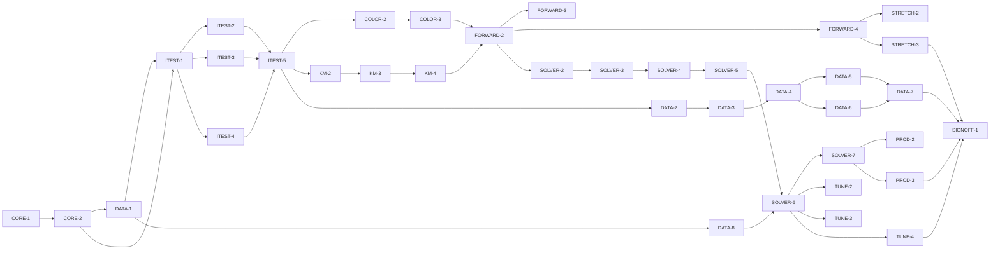

# Master Plan — pigment_km: measured-pigment Kubelka–Munk mixing engine

**Spec:** [pigment-km-engine.feature](../pigment-km-engine.feature)
**Status:** In progress — **G-9 resolved 2026-10-19: adopt a 10° observer** → needs a **plan-mode (`--plan`) upgrade** to add a colour re-base phase + re-grade the colour ACs before DATA-5/FORWARD-3/TUNE-3. Startable without the re-base: **STRETCH-2**, **STRETCH-3** (G-7 ✅ Build). DATA-6 on G-4; DATA-7 attribution wording on G-3. 20 ACs un-pended / 7 pending.
**Architecture:** [Nuance/docs/custom-mixing-engine-design.md](../../../Nuance/docs/custom-mixing-engine-design.md) (physics §3, datasets §4, forward/inverse §6, tuning §7, staged plan §8, licensing §13) · [Nuance/docs/paint-color-app-solution-intent.md](../../../Nuance/docs/paint-color-app-solution-intent.md) (D3/D6/D7/D9, accuracy NFRs) · consumption contract: `Nuance/lib/recipes/engine/mixing_engine.dart` (bs-04)
**Code home:** `/Users/matthew.quirk/pigment_km` · remote `https://github.com/meatsquirk/pigment-km` (origin, pushed) · base `main` · greenfield (new MIT-licensed Dart package) — confirmed by Matt Quirk, 2026-10-15

Standalone open-source Dart package, MIT-licensed with attribution to the source research (design §13). The Nuance app consumes it later behind its existing `MixingEngine` interface via a thin adapter (Nuance's work, out of this package's scope). Scope: the whole S0–S6 engine program (owner chose "whole program" 2026-10-15). Acrylic (Golden/RIT) is brought up end-to-end first; oil (MPI) second; STRETCH (S6) is optional behind G-7.

## Gap analysis (against the empty repo at init)

Greenfield — nothing exists yet; every AC is net-new. The gap is the whole library. Per-AC "what makes it hard / what it depends on":

| AC | Exists today | Missing / depends on |
|---|---|---|
| AC-1 spectrum→colour | nothing | CMF×D65 weights on the canonical grid; XYZ→sRGB (COLOR) |
| AC-2 gamut map | nothing | OKLCh chroma-reduction gamut map (COLOR) |
| AC-3 KM round-trip | nothing | KM reflectance fn + inverse f(R) (KM) |
| AC-4 Saunderson | nothing | per-medium k1,k2 (confirm from dataset READMEs — G-5) (KM) |
| AC-5 two-constant mix | nothing | Σv·K / Σv·S mixing + concentration model (KM) |
| AC-6 artifact | nothing | medium-tagged build-artifact format + loader + provenance/source-ref fields (DATA) |
| AC-7 round-trip fidelity | nothing | **real Golden/RIT K,S + published colours (G-3)** |
| AC-8 resample | nothing | native→canonical resampler (DATA) |
| AC-9 oil fit | nothing | **MPI oil reflectances+mixtures (G-4)** + per-λ NNLS (DATA) |
| AC-10 masstone–tint | nothing | least-squares K,S derivation (DATA) |
| AC-11 attribution | nothing | MIT LICENSE + NOTICE; **Golden/RIT wording per permission (G-3)** |
| AC-12 forward fidelity | nothing | COLOR+KM+DATA; **real measured mixtures (G-3/G-4)** |
| AC-13 desaturation | nothing | forward over real/synthetic K,S (FORWARD) |
| AC-14 normalize | nothing | volume normalization (FORWARD) |
| AC-15 ranked recipes | nothing | subset enumeration + per-subset optimizer (SOLVER) |
| AC-16 palette-only | nothing | palette constraint (SOLVER) |
| AC-17 in-gamut ≤5 | nothing | solver + **validation evidence (spectrophotometer — G-6)** |
| AC-18 out-of-gamut | nothing | gamut ceiling + honest nearest-match flag (SOLVER) |
| AC-19 cross-medium | nothing | palette partition by medium (SOLVER) |
| AC-20 performance | nothing | search within ~1–2 s (SOLVER; exclusive lane) |
| AC-21 curated palette | nothing | naturalistic default palette (TUNE; real data for the real palette — G-3) |
| AC-22 chromaPenalty | nothing | λ_natural tie-break regularizer (TUNE) |
| AC-23 wet/dry | nothing | per-medium wet→dry transform (TUNE; default — D-12) |
| AC-24 provenance | nothing | Calculated/Measured tiering (PROD) |
| AC-25 A/B | nothing | single-constant baseline engine + A/B harness (PROD) |
| AC-26 glazing | nothing | finite-thickness layering (STRETCH — G-7) |
| AC-27 metamerism | nothing | multi-illuminant eval + index (STRETCH — G-7) |

## Build order

| Stage | Phases |
|---|---|
| 1 Scaffold | CORE-1 |
| 2 Component shells | CORE-2, DATA-1 |
| 3 Acceptance tests | ITEST-1, ITEST-2, ITEST-3, ITEST-4, ITEST-5 (test review, G-2) |
| 4 Behavior | COLOR-2, COLOR-3, KM-2, KM-3, KM-4, FORWARD-2, FORWARD-3, FORWARD-4, DATA-2, DATA-3, DATA-4, DATA-5, DATA-6, DATA-7, DATA-8 (enabler), SOLVER-2, SOLVER-3, SOLVER-4, SOLVER-5, SOLVER-6, SOLVER-7, TUNE-2, TUNE-3, TUNE-4, PROD-2, PROD-3, STRETCH-2, STRETCH-3 |
| 5 Sign-off | SIGNOFF-1 |

## Acceptance criteria coverage

| AC | Scenario | Integration test (ITEST) | Behavior phases | Status |
|---|---|---|---|---|
| AC-1 | A reflectance spectrum converts to its expected colour | ITEST-2 `TestAC01_SpectrumToColour` | COLOR-2 | ✅ |
| AC-2 | Colours outside sRGB are gamut-mapped, not clipped | ITEST-2 `TestAC02_GamutMap` | COLOR-3 | ✅ |
| AC-3 | Kubelka–Munk reflectance and K/S round-trip | ITEST-2 `TestAC03_KmRoundTrip` | KM-2 | ✅ |
| AC-4 | Saunderson correction round-trips per medium | ITEST-2 `TestAC04_Saunderson` | KM-3 | ✅ |
| AC-5 | Two-constant mixing is linear and order-independent | ITEST-2 `TestAC05_TwoConstantMix` | FORWARD-2 (un-pend) · KM-4 (mixing ✅) | ✅ |
| AC-6 | The pigment table ships as a medium-tagged build artifact | ITEST-2 `TestAC06_Artifact` | DATA-3 | ✅ Done |
| AC-7 | Every ingested paint round-trips to its published colour | ITEST-2 `TestAC07_RoundTripFidelity` | DATA-5 | ⬜ Todo |
| AC-8 | Native dataset grids are resampled onto the canonical grid | ITEST-2 `TestAC08_Resample` | DATA-2 | ✅ Done |
| AC-9 | Oil K and S are fit from mixtures and validated on held-out ones | ITEST-2 `TestAC09_OilFit` | DATA-6 | ⬜ Todo |
| AC-10 | K and S are derived from a masstone and tint series | ITEST-3 `TestAC10_MasstoneTint` | DATA-4 | ✅ Done |
| AC-11 | Shipped data carries its licence attribution and correct provenance | ITEST-3 `TestAC11_Attribution` | DATA-7 | ⬜ Todo |
| AC-12 | The forward model predicts a known mixture's colour | ITEST-3 `TestAC12_ForwardFidelity` | FORWARD-3 | ⬜ Todo |
| AC-13 | Mixing two real pigments desaturates the way real paint does | ITEST-3 `TestAC13_Desaturation` | FORWARD-4 | ✅ Done |
| AC-14 | Volumes are normalized before mixing | ITEST-3 `TestAC14_Normalize` | FORWARD-2 | ✅ |
| AC-15 | The inverse solver returns ranked recipes preferring fewer paints | ITEST-3 `TestAC15_RankedPreferFewer` | SOLVER-3 | ✅ |
| AC-16 | Recipes use only paints in the declared palette | ITEST-3 `TestAC16_PaletteOnly` | SOLVER-2 | ✅ |
| AC-17 | An in-gamut target is matched within the recipe accuracy target | ITEST-3 `TestAC17_InGamut` | SOLVER-6 (coarse grid + successive refinement) | ✅ |
| AC-18 | An out-of-gamut target is flagged, never faked | ITEST-3 `TestAC18_OutOfGamut` | SOLVER-4 | ✅ |
| AC-19 | A single recipe never spans media | ITEST-4 `TestAC19_CrossMedium` | SOLVER-5 | ✅ |
| AC-20 | The solver returns within the performance budget | ITEST-4 `TestAC20_Performance` | SOLVER-7 | ✅ |
| AC-21 | The curated default palette cannot produce neon mixes | ITEST-4 `TestAC21_NoNeon` | TUNE-3 | ⬜ Todo |
| AC-22 | The chroma penalty breaks ΔE00 ties toward the more muted recipe | ITEST-4 `TestAC22_ChromaPenalty` | TUNE-2 | ✅ Done |
| AC-23 | The wet/dry toggle shifts the prediction by the documented offset | ITEST-4 `TestAC23_WetDry` | TUNE-4 | ✅ Done |
| AC-24 | Recipes from measured data are Calculated, user tubes Measured | ITEST-4 `TestAC24_Provenance` | PROD-2 | ✅ |
| AC-25 | The measured-pigment engine and a baseline engine are interchangeable | ITEST-4 `TestAC25_ABEngines` | PROD-3 | ✅ |
| AC-26 | A glaze over a ground predicts via the layering equation | ITEST-4 `TestAC26_Glazing` (@stretch) | STRETCH-2 | ⬜ Todo (G-7) |
| AC-27 | Illuminant-fragile matches are flagged with a metamerism index | ITEST-4 `TestAC27_Metamerism` (@stretch) | STRETCH-3 | ⬜ Todo (G-7) |

## Design decisions

| # | Decision | Why |
|---|---|---|
| D-1 | Canonical grid 400–700 nm @ 10 nm = 31 bins; resample every dataset onto it at ingest | the range both datasets share; one CMF/D65 weight set, cross-medium comparability (design §2/§4.3) |
| D-2 | Acrylic (Golden/RIT) first end-to-end; oil (MPI) second | owner's medium; Berns permission just granted; matches design §8 medium phasing / SI open decision #1 |
| D-3 | Standalone Dart package with its own colour types; Nuance adapts behind its `MixingEngine` | keeps the library dependency-free of Flutter; the adapter is Nuance's, so the library ships to pub |
| D-4 | Code MIT; third-party data kept under its own NOTICE | MIT is permissive, so embedded data needs a compatible licence/permission (design §13) |
| D-5 | Opaque (infinite-thickness) KM form; finite-layer glazing is STRETCH | both datasets are opaque-form; glazing needs transparent params (design §3.1/§3.4) |
| D-6 | Match targets in colour space (ΔE00), not spectrally, for the default illuminant | sidesteps metamerism for D65; matches what a CVD user perceives; spectral NNLS optional (design §6.2) |
| D-7 | A tiny synthetic pigment fixture unblocks the engine math + shells + most behavior before the real datasets land | only fidelity ACs (AC-7/9/12) and the real curated palette block on real data (G-3/G-4) |
| D-8 | Provenance: measured-data recipes = Calculated; a user-measured tube = Measured; a third-party dataset alone never reaches Measured | SI D9 honest-provenance rule |
| D-9 | Two engines behind one interface: single-constant "Spectral.js-style" baseline + two-constant `CustomKmEngine` | A/B at any time; the interface is the frozen contract (design §8 S0, SI D3) |
| D-10 | `chromaPenalty` λ_natural is small and tie-break-only; off in raw ΔE00 ranking | breaks ties toward naturalness without compromising the match (design §7 lever 2) |
| D-11 | STRETCH (glazing, metamerism) deferred behind G-7; `@stretch` scenarios excluded from the default acceptance run until enabled | S6 is "only if value is proven" (design §8/§9) |
| D-12 | Wet is the default predicted state; dry via toggle; the per-medium offset is a dataset/measured constant | SI open decision #6; both ship, the default is config |
| D-13 | The synthetic fixture (D-7) must render each chromatic paint as its *named* hue; when it doesn't, fix the fixture rather than retarget an AC | a paint named "blue" that renders orange makes synthetic targets meaningless and silently mis-scopes the in-gamut ACs (G-8, 2026-10-17) |

## Acceptance integration test plan

Module plan: [modules/ITEST.md](modules/ITEST.md).

**Where it lives and how it runs:** `test/acceptance/` in the package; pure-Dart `test` package (no device). Pending gate = a `pendingACs` map (AC → owning phase) + helper `ac('AC-n')` that calls `markTestSkipped` unless `PIGMENT_KM_RUN_PENDING=true`. Default target `dart test test/acceptance`; run-pending `PIGMENT_KM_RUN_PENDING=true dart test test/acceptance`. `@stretch` ACs (AC-26/27) are additionally excluded by tag (`dart test -x stretch`) until G-7. AC-20 (timing) runs in the exclusive lane.
**Where assertions look:** the package's public API only — `spectrumToColour`/gamut-map (COLOR), `kmReflectance`/`kmFunction`/`saunderson` (KM), `MixingEngine.forward`/`inverse`/`reflectanceOf`, `PigmentTable.load(medium)`, the `Recipe`/`Pigment`/`Provenance` value types. `reflectanceOf` is the spectral read endpoint for Thens that must inspect a mixture's spectrum.
**What is real and what is faked:** every COLOR/KM/DATA/FORWARD/SOLVER/TUNE/PROD component is real through the public API. The only fixture is a tiny synthetic pigment table with hand-authored K/S (D-7). The real datasets (post G-3/G-4) feed the fidelity ACs (AC-7/9/12) and the real curated palette (AC-21); nothing is faked to pass.

**Fixtures:**

| Fixture | Shape |
|---|---|
| `synthPigments` | 3–4 hand-authored paints (opaque white, a red, a blue, a yellow) with known K,S on the canonical grid; used by AC-3/5/13/14/15/16/18/22/24/25 and the harness |
| `refSpectrumColour` | a perfect diffuser (R=1) → D65 white point, plus one spectrum with a published XYZ/sRGB; AC-1 |
| `oogColour` | a highly chromatic target no synthetic mixture can reach; AC-18 |
| `acrylicPublished` | Golden/RIT paints + their published colours (post G-3); AC-7, AC-12, AC-21 real palette |
| `oilMixtures` | MPI pure + mixture reflectances with ratios, train/held-out split (post G-4); AC-9 |
| `illuminants` | D65 + a warm studio white as CMF-weight sets; AC-27 |

**Test catalogue:**

| AC | Given: built via public flows → checked by | When | Then: exact assertions | Rejects |
|---|---|---|---|---|
| AC-1 | load `refSpectrumColour` → assert its spectrum length == 31 and its published colour is set | convert via COLOR backend (D65, CIE-1931) | XYZ within tol; ΔE00(result, published) ≤ 1 | a backend that normalizes wrong / drops the illuminant weighting |
| AC-2 | construct an out-of-gamut colour → assert its chroma is outside sRGB before mapping | gamut-map | result inside sRGB; hue & L within tol; no channel pinned exactly at 0/1 as the match mechanism | a hard clip (would pin a channel and shift hue) |
| AC-3 | pick a K/S vector → assert it is finite and > 0 | `kmReflectance` then `kmFunction` | recovered K/S == original within 1e-6 | an implementation that swaps the branch sign of the quadratic |
| AC-4 | internal R + a medium's (k1,k2) → assert the two media's constants differ | internal→measured→internal | recovered R within 1e-6; **and** acrylic vs oil use different k1,k2 (control: same input, two media, two measured R) | a no-op Saunderson, or one global k1,k2 for all media |
| AC-5 | `synthPigments` subset + volumes summing to 1 → assert Σv==1 | mix K,S and predict | self-mix(any ratio)==paint colour; permuted order==same colour (control: a real 2-paint mix differs from each pure) | a mix that isn't volume-weighted, or order-dependent accumulation |
| AC-6 | load a medium's table → assert it is non-empty | read each paint | every paint: K,S length 31, pigmentIndex set, opacity in [0,1], provenance set, sourceRef set, medium == the loaded one | a loader that drops K/S or leaves provenance null |
| AC-7 | load `acrylicPublished` → assert each paint has a published colour (precondition names G-3/DATA-5) | render K,S→R∞→colour | ΔE00(rendered, published) ≤ 0.5 for **every** paint | wrong k1,k2 or grid (round-trip drifts); *limited until G-3 → augmentation* |
| AC-8 | a spectrum on a native grid (380–730 / 400–700) → assert its native length | ingest/resample | output length 31 on 400–700@10; endpoints & a known interior sample interpolate correctly | nearest-bin copy that misplaces wavelengths |
| AC-9 | `oilMixtures` train/held-out split → assert the split is disjoint and ratios are known (precondition names G-4/DATA-6) | per-λ NNLS fit on train, predict held-out | ΔE00(predicted, measured) ≤ 5 on held-out; all fit coeffs ≥ 0 | a fit allowing negative K/S, or one that trains on the held-out set; *limited until G-4* |
| AC-10 | masstone + tint series at known concentrations → assert tint count ≥ 2 and concentrations known | derive K,S across tints | derived K,S reproduce every tint's R within tol | fitting the masstone alone (under-determined); ignoring white's K_w,S_w |
| AC-11 | the built package tree → assert LICENSE & NOTICE files exist | inspect | LICENSE is MIT; NOTICE has the CC BY 4.0 MPI wording (names authors + states changes); Golden/RIT attribution present; each paint's provenance matches its source | a missing NOTICE, or data shipped with no attribution; *acrylic wording limited until G-3* |
| AC-12 | a measured mixture with a published colour → assert its parts are known (precondition G-3/G-4) | `forward` | ΔE00(prediction, measured) ≤ 5 | a forward that ignores S (single-constant); *limited until real data → augmentation* |
| AC-13 | two chromatic `synthPigments` of different hue → assert each pure chroma | mix equal volume, compare to linear-RGB blend | chroma(KM mix) < chroma(linear-RGB blend) | an engine that blends in RGB (stays vibrant) — this is the natural-colour check |
| AC-14 | parts not summing to 1 (e.g. 2:1:1 raw) → assert raw sum ≠ 1 | `forward` | result == forward of the same parts normalized to Σ1; concentration weights == normalized volumes | an engine that uses raw (unnormalized) weights |
| AC-15 | target + `synthPigments` palette → assert palette size & that ≥2 recipes tie is constructible | `inverse` | ≤ topK, ordered by ΔE00 ascending; on a tie the fewer-paint recipe is first (control: two equal-ΔE00 recipes, 2 vs 3 paints); parts Σ1 | sorting unstable / ignoring paint count on ties |
| AC-16 | target + a palette that excludes a tempting paint → assert that paint is absent from the palette | `inverse` | every paint in every recipe ∈ palette | a solver that reaches into the full dataset |
| AC-17 | an in-gamut target reachable by the palette → assert it is in gamut (via a known recipe) | `inverse`, take best | best ΔE00 ≤ 5 | a solver that stops early above 5; *validation evidence limited by G-6* |
| AC-18 | `oogColour` (unreachable) → assert no palette mix reaches it (control probe) | `inverse`, take best | best is flagged `outOfGamut`; carries its true ΔE00; never reported as a match | a solver that returns the nearest mix unflagged (a false recipe) |
| AC-19 | a mixed-medium palette (acrylic+oil) → assert both media present | `inverse` | every recipe is single-medium; solver searched each medium (control: a target best served by a cross-medium mix still returns single-medium) | a solver that mixes acrylic with oil paints |
| AC-20 | a ~15-paint palette → assert size ≈ 15 | `inverse` top-3 (exclusive lane, timed) | wall time ≤ ~2 s | an exponential search that blows the budget |
| AC-21 | the curated default palette → assert it is the curated set (precondition G-3 for the real one) | predict all mixtures / solve a muted & a neon target | no mixture exceeds the chroma ceiling; the muted target ≤ 5; the neon target returns out-of-gamut | a palette that admits neon primaries; *real palette limited until G-3* |
| AC-22 | two recipes tied on ΔE00, differing chroma → assert the tie & the chroma gap | rank with penalty on, then off | penalty-on ranks lower-chroma first; penalty-off ranking is ΔE00-only (unchanged order when no tie) | a penalty that always dominates ΔE00, or has no effect |
| AC-23 | a mixture predicted wet → assert the wet colour | predict dry | dry differs from wet by the medium's documented offset; acrylic dry is darker (lower L) & hue-shifted; parts & ΔE00-to-chosen-state-target unchanged | a no-op wet/dry, or one that re-solves and changes parts |
| AC-24 | a recipe from shipped measured data; and one using a user-measured tube → assert each source | read provenance | measured-data recipe == Calculated (not Measured/Estimated); user-tube recipe == Measured | a model that claims Measured from the dataset, or Estimated from measured data |
| AC-25 | a target+palette → assert both engines implement `MixingEngine` | solve with each via the interface | both return recipes with no caller change; A/B harness reports each engine's ΔE00 on the swatch set | a baseline wired differently (not through the interface) |
| AC-26 @stretch | a mix glazed at finite thickness X over ground Rg → assert X finite & Rg known | compute layered R | follows the §3.4 layering eqn; R→opaque as X→∞ (control: large X ≈ opaque form) | reusing the opaque form (ignores thickness/ground) |
| AC-27 @stretch | two recipes equal under D65 → assert equal D65 ΔE00 | evaluate under D65 + warm studio | the degrading recipe gets the higher metamerism index; an illuminant-fragile warning fires | an index computed under one illuminant only |

**Red baseline** and **test augmentations:** tracked in [modules/ITEST.md](modules/ITEST.md).
Pre-seeded augmentations: AC-7/AC-11/AC-21 strengthened by DATA-5/DATA-7/TUNE-3 when real acrylic data lands (G-3); AC-9 by DATA-6 when oil data lands (G-4); AC-12 by FORWARD-3 against measured mixtures; AC-17 validation by SOLVER-6 (and G-6 evidence). Until then each asserts against `synthPigments` and is graded *B pending <phase>*.

## Modules

| Module | Plan | Purpose | Depends on | Status |
|---|---|---|---|---|
| CORE | [modules/CORE.md](modules/CORE.md) | Package scaffold; canonical grid; core value types; `MixingEngine` interface + stub engines | — | ✅ Done |
| COLOR | [modules/COLOR.md](modules/COLOR.md) | Spectrum→XYZ→sRGB backend + OKLCh gamut map | CORE | ✅ Done (COLOR-2, COLOR-3) |
| KM | [modules/KM.md](modules/KM.md) | KM reflectance, Saunderson, two-constant mixing, concentration | CORE | ✅ Done (KM-2/3/4) |
| DATA | [modules/DATA.md](modules/DATA.md) | Pigment data model, ingest, resample, NNLS/masstone-tint, build artifact, attribution | CORE, COLOR, KM | 🔄 In progress (DATA-1 ✅, DATA-8 ✅) |
| FORWARD | [modules/FORWARD.md](modules/FORWARD.md) | `forward()` engine over measured pigments | COLOR, KM, DATA | 🔄 In progress (FORWARD-2 ✅) |
| SOLVER | [modules/SOLVER.md](modules/SOLVER.md) | `inverse()` palette-constrained solver | FORWARD | ✅ Done (SOLVER-2..7) |
| TUNE | [modules/TUNE.md](modules/TUNE.md) | Natural-colour tuning: curated palette, chromaPenalty, wet/dry | SOLVER, DATA | 🔄 In progress (TUNE-2 ✅, TUNE-4 ✅; TUNE-3 ↔ G-3) |
| PROD | [modules/PROD.md](modules/PROD.md) | Provenance wiring, baseline engine + A/B, interface freeze | SOLVER | ✅ Done (PROD-2 ✅, PROD-3 ✅) |
| STRETCH | [modules/STRETCH.md](modules/STRETCH.md) | Finite-layer glazing, metamerism (G-7 ✅ build) | FORWARD, COLOR | ⬜ Todo — startable (STRETCH-2, STRETCH-3) |
| ITEST | [modules/ITEST.md](modules/ITEST.md) | Acceptance integration suite: one pending test per AC, and its review | CORE, DATA shells | ✅ Done (ITEST-1..5; G-2 approved 2026-10-16) |

## Dependency graph

**Parallel windows:** after ITEST-5, the module heads COLOR-2, KM-2, DATA-2 start in parallel (disjoint files). KM-2→3→4 is a chain; SOLVER-2..7 is a chain. Merge-risky pairs: anything touching the shared `MixingEngine` surface or `lib/src/engine/*` — FORWARD-*/SOLVER-*/PROD-3 should not run concurrently; DATA-5/DATA-6 both touch the ingest path (serialize). TUNE-* and PROD-* read the solver but own separate files (safe to parallelize once SOLVER done).

## Open gates

| Gate | Kind | Decision needed | Blocks | Status |
|---|---|---|---|---|
| G-1 | decision | Approve the spec (record the approval as its first line) | CORE-1 | ✅ Resolved 2026-10-16: spec approved as-is, recorded as its first line — Matt Quirk |
| G-2 | decision | Approve the acceptance tests (ITEST-5's packet) | every behavior phase | ✅ Resolved 2026-10-16 11:08 EDT: approved — Matt Quirk. Routing: AC-23 wet/dry = post-prediction state transform (`forward`/`inverse` stay option-free, TUNE-4); AC-5 un-pend moves KM-4 → FORWARD-2 |
| G-3 | dependency | Obtain + archive the Golden/RIT acrylic K,S data; confirm its exact fields, grid, S-normalization and k1,k2 (design §4 action #2) and the agreed attribution wording with Berns/MCSL (permission granted 2026-10-15) | DATA-5, DATA-7, FORWARD-3, TUNE-3 (real palette) | ⏸ Data in hand 2026-10-19 (tool/ingest/raw/rit/, archived; fields/grid confirmed — see G-9); permission letter held 2026-10-17. Acquisition side satisfied; DATA-5 now blocked by the **observer mismatch — G-9**. DATA-7 attribution wording still to confirm (incl. IS&T paper-copyright). |
| G-4 | dependency | Obtain the MPI Old Holland oil dataset (CC BY 4.0 — clear) and its mixtures | DATA-6 | Open |
| G-5 | decision | Confirm per-medium Saunderson k1,k2 + S-normalization from each dataset README | DATA-5, DATA-6 (folds into G-3/G-4 acquisition) | Open |
| G-6 | dependency | Spectrophotometer availability for held-out ΔE00 validation evidence (SI open decision #3); MPI mixtures give a no-instrument oil path | AC-17 validation confidence (SOLVER-6) | Open |
| G-7 | decision | Confirm STRETCH (S6 glazing + metamerism) scope before building it | STRETCH-2, STRETCH-3 | ✅ Resolved 2026-10-19: **Build STRETCH** — glazing + metamerism confirmed in scope; STRETCH-2/3 startable; SIGNOFF-1 now also waits on STRETCH-2/3 — Matt Quirk |
| G-8 | decision | Synthetic fixture renders chromatic paints as the complement of their names (absorption K peaked at the named hue) — fix the fixture to be hue-faithful, or retarget AC-17? | DATA-8, SOLVER-6 (AC-17) | ✅ Resolved 2026-10-17: fix the fixture (new DATA-8 enabler); AC-17 keeps a genuinely in-gamut target — Matt Quirk |
| G-9 | decision | **Observer mismatch (surfaced DATA-5, 2026-10-19).** The Golden/RIT acrylic data is in hand (tool/ingest/raw/rit/, archived), fields/grid confirmed (Name, Prod #, % Reflectance, K/S, **published L\*a\*b\* under D65/10°**, on the 400–700@10 canonical grid — no resample). But the engine's colour pipeline is **CIE 1931 2°** (frozen COLOR, AC-1). Probe over all 78 paints: rendering each paint's measured reflectance (and, identically, its K/S column) through the 2° pipeline and comparing to the dataset's published Lab gives ΔE00 **max 6.75, mean 1.91, 66/78 > 0.5**, correlated with chroma (neutrals ≈ 0.05–0.11; saturated blues/yellows 4–6.7). AC-7 needs ≤ 0.5 for **every** paint — unachievable vs the dataset's 10° Lab with the 2° engine; no k1,k2/grid choice fixes an observer mismatch. **Decide:** (A) adopt a 10° observer for the colour pipeline to match the dataset [re-grade AC-1 + every colour-dependent AC; new COLOR phases]; (B) relax AC-7's threshold [spec change, weakens the AC]; (C) obtain/augment a dataset whose published colours are 2° (or raw spectra to render at 2°); (D) accept DATA-5 with a documented gap / keep AC-7 pending. | DATA-5, and the published-colour fidelity of FORWARD-3/TUNE-3 | ✅ Resolved 2026-10-19: **Adopt a 10° observer** for the colour pipeline to match the measured paint data — Matt Quirk. **Reshapes the plan** (changes frozen COLOR/AC-1): needs a plan-mode upgrade to add a colour re-base phase (recompute `cmf_d65_weights.dart` + white point for the CIE 10° observer) and re-grade AC-1 + every colour-dependent AC (COLOR/KM/FORWARD/SOLVER/TUNE/PROD). First confirm the MPI oil dataset's observer (fold into G-5) so oil fidelity isn't broken instead. Then DATA-5 (and FORWARD-3/TUNE-3 fidelity) can proceed. |

Resolved: `✅ Resolved <date time>: <decision, one line> — <who>`.

## Known flakes

| Test | Symptom | Rate (runs) | Measured at | Owner | Status |
|---|---|---|---|---|---|
| — | none yet (greenfield) | — | — | — | — |

## Session log

| # | Phase | Target | Status | Tokens | Time | Notes |
|---|---|---|---|---|---|---|
| 1 | CORE-1 | scaffold: package, `dart test`+coverage gate, baseline, acceptance runner | ✅ Done | 3.61M | 6m44s (33m) | G-1 resolved; gate proven |
| 2 | CORE-2 | shell: core types + `MixingEngine` interface + stub engines + canonical grid | ✅ Done | 4.25M | 8m49s | grid+types+interface+stubs; analyze clean, 28/28, cov 100% |
| 3 | DATA-1 | shell: build-artifact format + loader + synthetic fixture + attribution scaffolding | ✅ Done | 4.16M | 8m39s | artifact codec + `PigmentTable.load` + D-7 fixture (`estimated`) + shipped assets + ATTRIBUTION.md; analyze clean, 54/54, cov 100% |
| 4 | ITEST-1 | acceptance-tests: harness, fixtures, pending gate (all 27), smoke | ✅ Done | 5.53M | 12m 21s | harness+6 fixtures+pending gate (27 ACs, bijection-pinned)+smoke; analyze clean, acceptance 7/7 default==run-pending, grades 5 A/0 |
| 5 | ITEST-2 | acceptance-tests: AC-1..9 (pending) + red baseline | ✅ Done | 10.94M | 30m 21s | 8 A / 1 B-pending-DATA-6; red baseline +1/−8 (AC-6 green); Option-A backend stubs added |
| 6 | ITEST-3 | acceptance-tests: AC-10..18 (pending) + red baseline | ✅ Done | 10.79M | 22m 28s | 9 A (AC-11/12 data-limited); red baseline −9 each naming its owner; Option-A DATA-4 stub added |
| 7 | ITEST-4 | acceptance-tests: AC-19..27 (pending) + red baseline | ✅ Done | 6.34M | 16m 10s | 6 A / 1 A-data-limited (AC-21) / 2 B-pending (AC-26/27, G-7); red baseline −9 each for the right reason; no Option-A stubs; `@stretch` tagged |
| 8 | ITEST-5 | test-review: packet; G-2 | ✅ Done | 2.27M | 5m 13s | packet assembled (27 ACs, 24 A / 3 B-pending); G-2 approved 2026-10-16 (AC-23 post-prediction transform; AC-5 un-pend → FORWARD-2) |
| 9 | COLOR-2 | AC-1 spectrum→colour | ✅ Done | 7.64M | 17m 38s | CMF·D65 weights + spectrumToColour; AC-1 un-pended, green; cov 39/39; grade A |
| 10 | COLOR-3 | AC-2 gamut map | ✅ Done | 11.82M | 30m 37s | OKLCh chroma binary-search at fixed L+hue; conversions extracted to `oklch.dart` (+inverses); AC-2 un-pended, green; cov 16/16·42/42·14/14; grade 6 A (AC-2 B→A, fix 2/3); COLOR module ✅ |
| 11 | KM-2 | AC-3 KM round-trip | ✅ Done | 5.87M | 9m 58s (24m) | kmReflectance/kmFunction (−√ root + inverse); AC-3 un-pended, green; cov 11/11; grade A (2 A re-grade) |
| 12 | KM-3 | AC-4 Saunderson | ✅ Done | 7.45M | 15m 00s (15m 07s) | full Saunderson (k1,k2 per medium); AC-4 un-pended, green; cov 19/19; grade A (B→A in-phase, fix 1/3; 3 A re-grade) |
| 13 | KM-4 | two-constant mixing (enabler; AC-5 un-pends in FORWARD-2) | ✅ Done | 3.94M | 7m 52s (8m 09s) | `mixTwoConstant` Σv·K/Σv·S (no normalise); cov 16/16; enabler — no un-pend; KM module ✅ |
| 14 | FORWARD-2 | AC-14 normalize + AC-5 un-pend (enabler for forward) | ✅ Done | 11.23M | 17m 53s (39m 37s) | forward pipeline (normalize→mix→KM→Saunderson→colour) + reflectanceOf; AC-5 + AC-14 un-pended, green; cov forward 28/28, engine 11/11; grade 5 A (AC-14 B→A in-phase, fix 1/3); exposed `normalizeParts` |
| 15 | FORWARD-3 | AC-12 forward fidelity | ⬜ Todo | | | needs G-3/G-4 |
| 16 | FORWARD-4 | AC-13 desaturation | ✅ Done | 4.82M | 9m 00s | AC-13 un-pended, green (desaturation already holds via FORWARD-2 forward + DATA-8 hue-faithful fixture; no lib change); 11 A re-grade, 0 fixes; coverage-gate empty-array fix |
| 17 | DATA-2 | AC-8 resample | ✅ Done | 5.22M | 11m 07s | AC-8 un-pended, green; linear resampler onto canonical grid; cov 25/25; 12 A re-grade, 0 fixes |
| 18 | DATA-3 | AC-6 artifact | ✅ Done | 6.06M | 11m 08s | `load` decodes the shipped asset (single source), memoised; AC-6 un-pended, green; cov 12/12; 13 A re-grade, 0 fixes |
| 19 | DATA-4 | AC-10 masstone–tint | ✅ Done | 5.41M | 11m 24s | AC-10 un-pended, green; per-λ 2×2 least-squares K,S from masstone+tint series; backends_stub_test deleted (last stub done); cov 34/34; 14 A re-grade, 0 fixes |
| 20 | DATA-5 | AC-7 round-trip fidelity | ⬜ Todo | | | needs G-3 |
| 21 | DATA-6 | AC-9 oil fit | ⬜ Todo | | | needs G-4 |
| 22 | DATA-7 | AC-11 attribution + provenance | ⬜ Todo | | | needs G-3 wording |
| 23 | SOLVER-2 | AC-16 palette-only | ✅ Done | 9.98M | 17m 22s (1h 13m) | solver live; AC-16 un-pended, green; 7 A |
| 24 | SOLVER-3 | AC-15 ranked / prefer fewer | ✅ Done | 14.65M | 26m 58s (3h 30m) | AC-15 un-pended, green; prefer-fewer-on-tie tie-break; 8 A (AC-15 B→A in-phase); fix 1/3 |
| 25 | SOLVER-4 | AC-18 out-of-gamut | ✅ Done | 8.64M | 16m 37s (17m 34s) | AC-18 un-pended, green; target-level honest flag + verdict relabel; 9 A; fix 0/3 |
| 26 | SOLVER-5 | AC-19 cross-medium | ✅ Done | 7.94M | 13m 46s | AC-19 un-pended & green; per-medium partition + pooled ranking; control proves each medium searched; 10 A; fix 0/3 |
| 27 | DATA-8 | enabler: fix synthetic fixture hue faithfulness (G-8) + re-verify/re-grade whole suite | ✅ Done | 7.65M | 15m 08s | inverted `_chroma` K (reflects at hue); blue/red/oil hues faithful; assets regen (parity ✅); suite 136 green + run-pending red baseline; cov 32/32; AC-18 oog holds (ΔE00 32.40); AC-17 reachable ΔE00 3.69; re-grade 10 A; SOLVER-6 dep drift flagged |
| 28 | SOLVER-6 | AC-17 in-gamut ≤5 | ✅ Done | 10.67M | 18m 12s | AC-17 un-pended, green; coarse grid + successive refinement (3 rounds ×4, Σ=1 shares in (0,1)); reachable near-pure tint 6.4→0.05 ΔE00; stale FORWARD-3 dep reconciled → DATA-8 enabler; cov 143/143; 15 A re-grade; fix 0/3; validation ↔ G-6 |
| 29 | SOLVER-7 | AC-20 performance | ✅ Done | 11.78M | 24m 11s | AC-20 un-pended & green; adaptive `maxPaints` cap (subset-count budget) + bit-identical per-subset precompute (`BoundForward`); maxPaints 5/6/8 on 15 paints 2.6/8.7/8.7s→~0.31s; exclusive-lane AC-20 green; test augmented (maxPaints=8 rejects uncapped exponential); cov forward 65/65·inverse 146/146; 16 A re-grade; fix 0/3; SOLVER module ✅ |
| 30 | TUNE-2 | AC-22 chromaPenalty | ✅ Done | 14.91M | 30m 48s | AC-22 un-pended & green; λ=1e-6 chroma-penalty tie-break (`chroma_penalty.dart`) off in raw ranking; out-of-gamut reads true ΔE00 min; constructed 3-paint-muted vs 2-paint-vivid tie discriminates from AC-15 fewer-paints; 17 A re-grade; fix 1/3 |
| 31 | TUNE-3 | AC-21 curated palette | ⬜ Todo | | | real palette ↔ G-3 |
| 32 | TUNE-4 | AC-23 wet/dry | ✅ Done | 8.87M | 16m 55s | AC-23 un-pended & green; per-medium wet→dry as a post-prediction state transform (`wet_dry.dart`: XYZ→L*C*h + documented offset → consistent triple); acrylic `WetDryTransform(-3,1.5,3)` (dry darker+hue-shifted), oil none (G-4/G-5); `inverse` reads `opts.wet`, solve stays option-free (G-2); parts/ΔE00 unchanged; 18 A re-grade; cov 47/47·19/19·15/15; fix 0/3 |
| 33 | PROD-2 | AC-24 provenance | ✅ Done | 7.07M | 12m 45s | AC-24 un-pended & green; recipe tier = weakest input (estimated<calculated<measured<confirmed); new `engine/provenance.dart`; dataset→Calculated, user tube→Measured; 19 A re-grade, 0 downgrades; cov 146/146·9/9; fix 0/3; DATA-7 dep was drift |
| 34 | PROD-3 | AC-25 A/B engines | ✅ Done | 11.30M | 18m 43s | AC-25 un-pended & green; single-constant `SpectralBaselineEngine` (mixes per-λ K/S ratios, vs two-constant's separate Kmix/Smix) behind the now-frozen `MixingEngine`; new `ab/ab_harness.dart` (`ABHarness`/`ABReport`); barrel export; 20 A re-grade, 0 downgrades; cov 117/117·24/24; fix 0/3; module PROD done |
| 35 | STRETCH-2 | AC-26 glazing | ⬜ Todo | | | G-7 |
| 36 | STRETCH-3 | AC-27 metamerism | ⬜ Todo | | | G-7 |
| 37 | SIGNOFF-1 | sign-off: packet + summary + manual approval | ⬜ Todo | | | |

*Tokens* / *Time* = phase totals from the *Token usage* ledger (Time = active, wall in brackets), filled when a row is marked done.

## Next phase

**PROD-3 ✅ (2026-10-19): AC-25 A/B interchangeable engines un-pended, green — `MixingEngine` frozen, module PROD done.** The single-constant `SpectralBaselineEngine` is complete and `ABHarness` ships, so the measured-pigment `CustomKmEngine` and the baseline drive through the identical `inverse(target, palette, opts)` call with no caller change (SI D3). Baseline = genuine single-constant: each paint reduced to its per-λ `K/S` ratio, those mixed linearly (vs the two-constant engine's separate `Kmix`/`Smix`), then the shared `kmReflectance → saundersonToMeasured → spectrumToColour` pipeline; its `inverse` is a self-contained subset search (per-medium partition, coarse grid + refinement, best-first/fewer-paints ranking, honest OOG flag) reusing `deltaE2000Xyz` + `recipeProvenance`. `lib/src/ab/ab_harness.dart` (`ABHarness`/`ABReport`, barrel-exported) reports each engine's per-swatch and mean ΔE00 on a shared set. Grade gate: 20 A, 0 downgrades; cov baseline 117/117 · harness 24/24; fix 0/3. 20 un-pended / 7 pending. The baseline is a *reference* model — it omits the TUNE chroma penalty and predicts wet-state only (both product levers), by design.

**2026-10-19: G-7 resolved (Build STRETCH) → STRETCH-2/3 now startable.** G-7 is closed (owner: build glazing + metamerism). STRETCH-2 (AC-26 glazing) and STRETCH-3 (AC-27 metamerism) are the only ungated startable phases now; each runs in its own session. STRETCH-2 depends on FORWARD-4 (done); STRETCH-3 on COLOR-2/FORWARD-2 (done). `@stretch` scenarios are excluded from the default acceptance run — enabling them is part of each STRETCH phase.

**2026-10-19: DATA-5 attempted, stopped before code — observer mismatch, G-9 now resolved (adopt 10°).** The Golden/RIT acrylic data is in hand and its fields/grid are confirmed, but AC-7's ≤ 0.5 round-trip to the dataset's **D65/10°** published Lab was unachievable under the frozen **CIE 1931 2°** colour pipeline (probe: 66/78 paints > 0.5, max 6.75, chroma-correlated). **G-9 resolved: adopt a 10° observer.** No DATA-5 code written.

- **Next (recommended): a `--plan` upgrade** to add a colour re-base phase (recompute `lib/src/colour/cmf_d65_weights.dart` + the white point for the CIE 10° observer; the barrel/`spectrumToColour` surface is unchanged) and re-grade AC-1 + every colour-dependent AC. Confirm the MPI oil dataset's observer first (fold into G-5). This unblocks DATA-5, FORWARD-3, TUNE-3 fidelity.
- **Startable now without the re-base:** STRETCH-2 (AC-26 glazing), STRETCH-3 (AC-27 metamerism) — independent of the acrylic dataset; can run in parallel. (Note: the re-base will touch their colour outputs too, so grading them before vs after the re-base is a sequencing choice for the `--plan` upgrade.)
- **Gate-blocked:** DATA-5 (AC-7), FORWARD-3 (AC-12), TUNE-3 (AC-21) behind the 10° re-base; DATA-7 (AC-11) on **G-3** attribution wording; DATA-6 (AC-9) on **G-4**. G-6 adds AC-17 held-out validation *evidence* (not solver logic).
- **SIGNOFF-1** waits on DATA-5/6/7, FORWARD-3, TUNE-3, STRETCH-2/3 and the 10° re-base + re-grade.

To advance, a human must resolve a dataset/scope gate (G-3, G-4, or G-7) — see *Open gates*. Nothing in this feature is startable without one.

## Token usage

<!-- One row per session, appended as that session's last edit. -->

| Phase / activity | Session | Start | End | Wall | Active | Model(s) | Input | Cache write | Cache read | Output | Total | Outcome |
|---|---|---|---|---|---|---|---|---|---|---|---|---|
| PLAN | <this> | | | | | opus-4-8 | | | | | | plan written |
| PLAN | c99d445d | 2026-10-15 21:14 EDT | 21:32 | 18m 36s | 16m 07s | claude-opus-4-8 | 50 | 156,218 | 3,218,973 | 75,301 | 3,450,542 | plan written |
| CORE-1 | e9114773 | 2026-10-16 05:48 EDT | 06:21 | 32m 58s | 6m 44s | claude-opus-4-8 | 86 | 76,569 | 3,510,091 | 26,207 | 3,612,953 | scaffold done; coverage gate proven; G-1 approved |
| CORE-2 | af675ed1 | 2026-10-16 06:30 EDT | 06:39 | 8m 49s | 8m 49s | claude-opus-4-8 | 88 | 105,042 | 4,109,310 | 37,596 | 4,252,036 | shell: grid+value types+MixingEngine interface+stub engines; analyze clean, 28/28 unit, coverage 100% touched |
| DATA-1 | f03bdf08 | 2026-10-16 07:19 EDT | 07:27 | 8m 39s | 8m 39s | claude-opus-4-8 | 86 | 95,256 | 4,030,089 | 36,264 | 4,161,695 | shell: artifact codec + PigmentTable.load + D-7 synthetic fixture + shipped assets + ATTRIBUTION.md; analyze clean, 54/54 unit, coverage 100% touched |
| ITEST-1 | f47243c8 | 2026-10-16 07:35 EDT | 07:47 | 12m 21s | 12m 21s | claude-opus-4-8 | 94 | 174,792 | 5,309,659 | 47,833 | 5,532,378 | harness + fixtures + pending gate (27 ACs) + smoke; analyze clean, acceptance 7/7 default==run-pending, grades 5 A/0 |
| ITEST-2 | 8a7179c9 | 2026-10-16 08:01 EDT | 08:32 | 30m 59s | 30m 21s | claude-opus-4-8 | 144 | 286,271 | 10,546,135 | 111,313 | 10,943,863 | AC-1..9 pending + red baseline; 8 A / 1 B-pending-DATA-6; Option-A backend stubs; harness skip bug fixed |
| ITEST-3 | 70fbb425 | 2026-10-16 08:35 EDT | 08:58 | 22m 28s | 22m 28s | claude-opus-4-8 | 152 | 273,308 | 10,438,132 | 80,246 | 10,791,838 | AC-10..18 pending + red baseline; 9 A (AC-11/12 data-limited, AC-15 fixed B→A); Option-A DATA-4 stub; analyze clean, default 70/18, coverage PASS |
| ITEST-4 | 0f8bbd98 | 2026-10-16 09:10 EDT | 09:27 | 16m 10s | 16m 10s | claude-opus-4-8 | 108 | 202,680 | 6,082,471 | 57,386 | 6,342,645 | AC-19..27 pending + red baseline (−9 each right reason); grades 6 A / 1 A-data-limited / 2 B-pending (G-7); no Option-A stubs; @stretch tagged |
| ITEST-5 | 1e7e17af | 2026-10-16 10:09 EDT | 10:15 | 5m 13s | 5m 13s | claude-opus-4-8 | 46 | 107,864 | 2,143,635 | 19,764 | 2,271,309 | packet assembled; ⏸ awaiting G-2 decision; 24 A / 3 B-pending; suite re-verified green + red baseline |
| SIGNOFF-DECISION | 4716a8e4 | 2026-10-16 10:46 EDT | 11:12 | 25m 52s | 5m 30s | claude-opus-4-8 | 66 | 77,272 | 2,826,847 | 24,635 | 2,928,820 | ITEST-5 approved |
| COLOR-2 | b02bec01 | 2026-10-16 11:40 EDT | 11:58 | 17m 38s | 17m 38s | claude-opus-4-8 | 130 | 195,076 | 7,381,010 | 61,136 | 7,637,352 | AC-1 spectrum→colour: CMF·D65 weights + spectrumToColour; AC-1 un-pended green; analyze clean, unit 78/26/0, coverage PASS (39/39), acceptance 8/26, grade A |
| KM-2 | 19d8dfed | 2026-10-16 12:12 EDT | 12:36 | 24m 14s | 9m 58s | claude-opus-4-8 | 124 | 151,757 | 5,681,402 | 32,551 | 5,865,834 | AC-3 KM round-trip: kmReflectance/kmFunction; AC-3 un-pended green; analyze clean, unit 87/25/0, coverage PASS (11/11), acceptance 9/25, grade A (2 A re-grade) |
| KM-3 | 5a2d2947 | 2026-10-16 12:59 EDT | 13:14 | 15m 07s | 15m 00s | claude-opus-4-8 | 150 | 238,821 | 7,168,361 | 44,906 | 7,452,238 | AC-4 Saunderson: un-pended & green; cov 19/19; grade A (B→A in-phase, fix 1/3) |
| KM-4 | eb784026 | 2026-10-16 13:22 EDT | 13:30 | 8m 09s | 7m 52s | claude-opus-4-8 | 86 | 92,796 | 3,816,973 | 32,531 | 3,942,386 | KM-4 enabler done — mixTwoConstant (Σv·K/Σv·S, no normalise); analyze clean, unit 108/24 skip, coverage 16/16, acceptance green (24 pending); no un-pend (AC-5 gate in FORWARD-2); fix passes 0/3 |
| FORWARD-2 | 9a6f8357 | 2026-10-16 13:35 EDT | 14:15 | 39m 37s | 17m 53s | claude-opus-4-8 | 176 | 293,333 | 10,877,805 | 60,014 | 11,231,328 | forward model live (normalize→mix→KM→Saunderson→colour) + reflectanceOf; AC-5 + AC-14 un-pended, green; cov forward 28/28, engine 11/11; analyze clean, unit 115/22 skip; grade 5 A (AC-14 B→A in-phase, fix 1/3; exposed normalizeParts) |
| COLOR-3 | 9e9df8eb | 2026-10-16 14:22 EDT | 14:52 | 30m 37s | 30m 37s | claude-opus-4-8 | 210 | 406,386 | 11,351,837 | 66,365 | 11,824,798 | AC-2 gamut map un-pended, green; 6 A (AC-2 B→A, fix 2/3); COLOR module complete |
| SOLVER-2 | d8949058 | 2026-10-16 18:11 EDT | 19:24 | 1h 13m | 17m 22s | claude-opus-4-8 | 168 | 256,010 | 9,662,102 | 61,298 | 9,979,578 | AC-16 palette-only un-pended, green; 7 A |
| SOLVER-3 | f5bf67c0 | 2026-10-16 19:43 EDT | 23:13 | 3h 30m | 26m 58s | claude-opus-4-8 | 194 | 369,211 | 14,188,230 | 94,192 | 14,651,827 | AC-15 ranked/prefer-fewer-on-tie un-pended & green; 8 A (AC-15 B→A in-phase); analyze clean, default 130/19, acceptance 16/19, coverage inverse.dart 113/113; fix 1/3 |
| SOLVER-4 | 3f5220a2 | 2026-10-17 04:35 EDT | 04:52 | 17m 34s | 16m 37s | claude-opus-4-8 | 158 | 234,333 | 8,353,412 | 53,482 | 8,641,385 | AC-18 un-pended & green; honest target-level out-of-gamut flag; 9 A; coverage 122/122; fix 0/3 |
| SOLVER-5 | 5416ac89 | 2026-10-17 07:51 EDT | 08:04 | 13m 46s | 13m 46s | claude-opus-4-8 | 140 | 270,382 | 7,616,700 | 49,461 | 7,936,683 | AC-19 un-pended & green; per-medium partition; 10 A; fix 0/3 |
| GATE-DECISION | 6c65bcda | 2026-10-17 08:08 EDT | 08:35 | 27m 48s | 13m 59s | claude-opus-4-8 | 86 | 153,485 | 5,488,586 | 59,766 | 5,701,923 | G-8: fix synthetic fixture complement-hue bug — added DATA-8 enabler, repointed SOLVER-6 (AC-17) |
| DATA-8 | 247d6801 | 2026-10-17 09:54 EDT | 10:09 | 15m 08s | 15m 08s | claude-opus-4-8 | 136 | 246,091 | 7,350,660 | 57,116 | 7,654,003 | enabler: synthetic fixture hue-faithful; suite green 136; coverage 32/32; AC-17 reachable ΔE00 3.69; AC-18 oog holds; re-grade 10 A |
| FORWARD-4 | e1d27a7d | 2026-10-17 18:06 EDT | 18:15 | 9m 00s | 9m 00s | claude-opus-4-8 | 102 | 235,263 | 4,560,685 | 25,737 | 4,821,787 | AC-13 un-pended, green; 11 A re-grade, 0 fixes; coverage-gate empty-array fix |
| DATA-2 | 8deacf3c | 2026-10-17 21:08 EDT | 21:19 | 11m 07s | 11m 07s | claude-opus-4-8 | 116 | 211,031 | 4,985,591 | 27,284 | 5,224,022 | AC-8 un-pended, green; linear resampler; cov 25/25; 12 A re-grade, 0 fixes |
| DATA-3 | 6b7aac0b | 2026-10-18 15:07 EDT | 15:18 | 11m 08s | 11m 08s | claude-opus-4-8 | 118 | 202,672 | 5,816,522 | 37,877 | 6,057,189 | AC-6 un-pended green; load decodes shipped asset (single source), memoised; cov 12/12; 13 A re-grade, 0 fixes |
| DATA-4 | 43cd7aba | 2026-10-18 15:40 EDT | 15:51 | 11m 24s | 11m 24s | claude-opus-4-8 | 104 | 189,309 | 5,178,278 | 37,927 | 5,405,618 | AC-10 un-pended green; per-λ 2×2 least-squares masstone–tint K,S derivation; backends_stub_test deleted; analyze clean, default 156/13, run-pending baseline correct, cov 34/34 PASS; 14 A re-grade, 0 fixes |
| SOLVER-6 | 06d76f91 | 2026-10-18 15:57 EDT | 16:15 | 18m 12s | 18m 12s | claude-opus-4-8 | 184 | 220,850 | 10,384,588 | 62,283 | 10,667,905 | AC-17 un-pended & green; coarse grid + successive refinement; 15 A re-grade; cov 143/143; fix 0/3 |
| SOLVER-7 | a7c22cfd | 2026-10-18 20:19 EDT | 20:43 | 24m 11s | 24m 11s | claude-opus-4-8 | 176 | 252,185 | 11,434,831 | 91,063 | 11,778,255 | AC-20 un-pended & green; SOLVER module complete; 16 A re-grade; cov forward 65/65 inverse 146/146; fix 0/3 |
| TUNE-2 | e9af57c3 | 2026-10-18 21:01 EDT | 21:32 | 30m 48s | 30m 48s | claude-opus-4-8 | 176 | 341,464 | 14,452,798 | 111,114 | 14,905,552 | AC-22 un-pended & green; chroma-penalty tie-break; 17 A re-grade, 0 downgrades; cov 148/148 + 2/2; fix 1/3 |
| TUNE-4 | b9024ea1 | 2026-10-19 05:20 EDT | 05:36 | 16m 55s | 16m 55s | claude-opus-4-8 | 140 | 242,155 | 8,572,317 | 59,382 | 8,873,994 | AC-23 wet/dry un-pended & green; post-prediction state transform; 18 A re-grade, 0 downgrades; cov 47/47+19/19+15/15; fix 0/3 |
| PROD-2 | 6545e916 | 2026-10-19 05:41 EDT | 05:54 | 12m 45s | 12m 45s | claude-opus-4-8 | 144 | 191,626 | 6,837,961 | 38,590 | 7,068,321 | AC-24 provenance tiering un-pended & green; 19 A re-grade, 0 downgrades; cov 146/146·9/9; fix 0/3 |
| PROD-3 | 70fd77ae | 2026-10-19 06:10 EDT | 06:29 | 18m 43s | 18m 43s | claude-opus-4-8 | 182 | 262,778 | 10,970,064 | 66,543 | 11,299,567 | AC-25 A/B engines un-pended & green; 20 A, 0 downgrades; cov 117/117·24/24; fix 0/3; MixingEngine frozen, module PROD done |
| GATE-DECISION | 53e1b2dc | 2026-10-19 06:36 EDT | 08:02 | 1h 26m | 19m 24s | claude-opus-4-8 | 96 | 154,332 | 6,320,217 | 75,718 | 6,550,363 | G-7 approved (Build STRETCH → STRETCH-2/3 startable); G-9 resolved (adopt 10° observer) — reshapes plan, needs --plan upgrade for a colour re-base + re-grade before DATA-5/FORWARD-3/TUNE-3; DATA-5 attempted, no code (probe 66/78 >0.5 vs 10° Lab under 2° engine) |
| **Feature total** |  | **2026-10-15 21:14 EDT** | **2026-10-19 08:02** | **15h 24m** | **8h 38m** |  | **4,216** | **6,966,618** | **240,666,272** | **1,822,881** | **249,459,987** |  |

## Sign-off

| Round | Packet | At code | Grades | Decision |
|---|---|---|---|---|
| 1 | [signoff/round-1.md](signoff/round-1.md) | — | — | ⬜ not reached |
