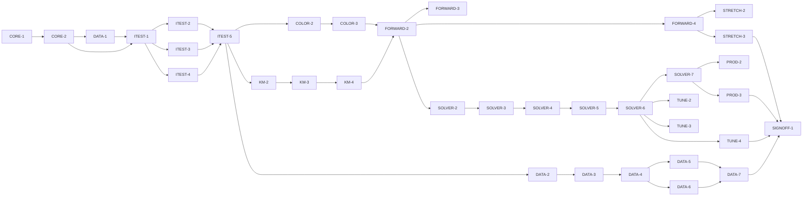

# Master Plan — pigment_km: measured-pigment Kubelka–Munk mixing engine

**Spec:** [pigment-km-engine.feature](../pigment-km-engine.feature)
**Status:** Not started — next CORE-1 (blocked by G-1: approve the spec)
**Architecture:** [Nuance/docs/custom-mixing-engine-design.md](../../../Nuance/docs/custom-mixing-engine-design.md) (physics §3, datasets §4, forward/inverse §6, tuning §7, staged plan §8, licensing §13) · [Nuance/docs/paint-color-app-solution-intent.md](../../../Nuance/docs/paint-color-app-solution-intent.md) (D3/D6/D7/D9, accuracy NFRs) · consumption contract: `Nuance/lib/recipes/engine/mixing_engine.dart` (bs-04)
**Code home:** `/Users/matthew.quirk/pigment_km` · remote **TBD — create at CORE-1** (user to provide GitHub URL) · base `main` · greenfield (new MIT-licensed Dart package) — confirmed by Matt Quirk, 2026-10-15

Standalone open-source Dart package, MIT-licensed with attribution to the source research (design §13). The Nuance app consumes it later behind its existing `MixingEngine` interface via a thin adapter (Nuance's work, out of this package's scope). Scope: the whole S0–S6 engine program (owner chose "whole program" 2026-10-15). Acrylic (Golden/RIT) is brought up end-to-end first; oil (MPI) second; STRETCH (S6) is optional behind G-7.

## Gap analysis (against the empty repo at init)

Greenfield — nothing exists yet; every AC is net-new. The gap is the whole library. Per-AC "what makes it hard / what it depends on":

| AC | Exists today | Missing / depends on |
|---|---|---|
| AC-1 spectrum→colour | nothing | CMF×D65 weights on the canonical grid; XYZ→sRGB (COLOR) |
| AC-2 gamut map | nothing | OKLCh chroma-reduction gamut map (COLOR) |
| AC-3 KM round-trip | nothing | KM reflectance fn + inverse f(R) (KM) |
| AC-4 Saunderson | nothing | per-medium k1,k2 (confirm from dataset READMEs — G-5) (KM) |
| AC-5 two-constant mix | nothing | Σv·K / Σv·S mixing + concentration model (KM) |
| AC-6 artifact | nothing | medium-tagged build-artifact format + loader + provenance/source-ref fields (DATA) |
| AC-7 round-trip fidelity | nothing | **real Golden/RIT K,S + published colours (G-3)** |
| AC-8 resample | nothing | native→canonical resampler (DATA) |
| AC-9 oil fit | nothing | **MPI oil reflectances+mixtures (G-4)** + per-λ NNLS (DATA) |
| AC-10 masstone–tint | nothing | least-squares K,S derivation (DATA) |
| AC-11 attribution | nothing | MIT LICENSE + NOTICE; **Golden/RIT wording per permission (G-3)** |
| AC-12 forward fidelity | nothing | COLOR+KM+DATA; **real measured mixtures (G-3/G-4)** |
| AC-13 desaturation | nothing | forward over real/synthetic K,S (FORWARD) |
| AC-14 normalize | nothing | volume normalization (FORWARD) |
| AC-15 ranked recipes | nothing | subset enumeration + per-subset optimizer (SOLVER) |
| AC-16 palette-only | nothing | palette constraint (SOLVER) |
| AC-17 in-gamut ≤5 | nothing | solver + **validation evidence (spectrophotometer — G-6)** |
| AC-18 out-of-gamut | nothing | gamut ceiling + honest nearest-match flag (SOLVER) |
| AC-19 cross-medium | nothing | palette partition by medium (SOLVER) |
| AC-20 performance | nothing | search within ~1–2 s (SOLVER; exclusive lane) |
| AC-21 curated palette | nothing | naturalistic default palette (TUNE; real data for the real palette — G-3) |
| AC-22 chromaPenalty | nothing | λ_natural tie-break regularizer (TUNE) |
| AC-23 wet/dry | nothing | per-medium wet→dry transform (TUNE; default — D-12) |
| AC-24 provenance | nothing | Calculated/Measured tiering (PROD) |
| AC-25 A/B | nothing | single-constant baseline engine + A/B harness (PROD) |
| AC-26 glazing | nothing | finite-thickness layering (STRETCH — G-7) |
| AC-27 metamerism | nothing | multi-illuminant eval + index (STRETCH — G-7) |

## Build order

| Stage | Phases |
|---|---|
| 1 Scaffold | CORE-1 |
| 2 Component shells | CORE-2, DATA-1 |
| 3 Acceptance tests | ITEST-1, ITEST-2, ITEST-3, ITEST-4, ITEST-5 (test review, G-2) |
| 4 Behavior | COLOR-2, COLOR-3, KM-2, KM-3, KM-4, FORWARD-2, FORWARD-3, FORWARD-4, DATA-2, DATA-3, DATA-4, DATA-5, DATA-6, DATA-7, SOLVER-2, SOLVER-3, SOLVER-4, SOLVER-5, SOLVER-6, SOLVER-7, TUNE-2, TUNE-3, TUNE-4, PROD-2, PROD-3, STRETCH-2, STRETCH-3 |
| 5 Sign-off | SIGNOFF-1 |

## Acceptance criteria coverage

| AC | Scenario | Integration test (ITEST) | Behavior phases | Status |
|---|---|---|---|---|
| AC-1 | A reflectance spectrum converts to its expected colour | ITEST-2 `TestAC01_SpectrumToColour` | COLOR-2 | ⬜ Todo |
| AC-2 | Colours outside sRGB are gamut-mapped, not clipped | ITEST-2 `TestAC02_GamutMap` | COLOR-3 | ⬜ Todo |
| AC-3 | Kubelka–Munk reflectance and K/S round-trip | ITEST-2 `TestAC03_KmRoundTrip` | KM-2 | ⬜ Todo |
| AC-4 | Saunderson correction round-trips per medium | ITEST-2 `TestAC04_Saunderson` | KM-3 | ⬜ Todo |
| AC-5 | Two-constant mixing is linear and order-independent | ITEST-2 `TestAC05_TwoConstantMix` | KM-4 | ⬜ Todo |
| AC-6 | The pigment table ships as a medium-tagged build artifact | ITEST-2 `TestAC06_Artifact` | DATA-3 | ⬜ Todo |
| AC-7 | Every ingested paint round-trips to its published colour | ITEST-2 `TestAC07_RoundTripFidelity` | DATA-5 | ⬜ Todo |
| AC-8 | Native dataset grids are resampled onto the canonical grid | ITEST-2 `TestAC08_Resample` | DATA-2 | ⬜ Todo |
| AC-9 | Oil K and S are fit from mixtures and validated on held-out ones | ITEST-2 `TestAC09_OilFit` | DATA-6 | ⬜ Todo |
| AC-10 | K and S are derived from a masstone and tint series | ITEST-3 `TestAC10_MasstoneTint` | DATA-4 | ⬜ Todo |
| AC-11 | Shipped data carries its licence attribution and correct provenance | ITEST-3 `TestAC11_Attribution` | DATA-7 | ⬜ Todo |
| AC-12 | The forward model predicts a known mixture's colour | ITEST-3 `TestAC12_ForwardFidelity` | FORWARD-3 | ⬜ Todo |
| AC-13 | Mixing two real pigments desaturates the way real paint does | ITEST-3 `TestAC13_Desaturation` | FORWARD-4 | ⬜ Todo |
| AC-14 | Volumes are normalized before mixing | ITEST-3 `TestAC14_Normalize` | FORWARD-2 | ⬜ Todo |
| AC-15 | The inverse solver returns ranked recipes preferring fewer paints | ITEST-3 `TestAC15_RankedFewer` | SOLVER-3 | ⬜ Todo |
| AC-16 | Recipes use only paints in the declared palette | ITEST-3 `TestAC16_PaletteOnly` | SOLVER-2 | ⬜ Todo |
| AC-17 | An in-gamut target is matched within the recipe accuracy target | ITEST-3 `TestAC17_InGamut` | SOLVER-6 | ⬜ Todo |
| AC-18 | An out-of-gamut target is flagged, never faked | ITEST-3 `TestAC18_OutOfGamut` | SOLVER-4 | ⬜ Todo |
| AC-19 | A single recipe never spans media | ITEST-4 `TestAC19_CrossMedium` | SOLVER-5 | ⬜ Todo |
| AC-20 | The solver returns within the performance budget | ITEST-4 `TestAC20_Performance` | SOLVER-7 | ⬜ Todo |
| AC-21 | The curated default palette cannot produce neon mixes | ITEST-4 `TestAC21_NoNeon` | TUNE-3 | ⬜ Todo |
| AC-22 | The chroma penalty breaks ΔE00 ties toward the more muted recipe | ITEST-4 `TestAC22_ChromaPenalty` | TUNE-2 | ⬜ Todo |
| AC-23 | The wet/dry toggle shifts the prediction by the documented offset | ITEST-4 `TestAC23_WetDry` | TUNE-4 | ⬜ Todo |
| AC-24 | Recipes from measured data are Calculated, user tubes Measured | ITEST-4 `TestAC24_Provenance` | PROD-2 | ⬜ Todo |
| AC-25 | The measured-pigment engine and a baseline engine are interchangeable | ITEST-4 `TestAC25_ABEngines` | PROD-3 | ⬜ Todo |
| AC-26 | A glaze over a ground predicts via the layering equation | ITEST-4 `TestAC26_Glazing` (@stretch) | STRETCH-2 | ⬜ Todo (G-7) |
| AC-27 | Illuminant-fragile matches are flagged with a metamerism index | ITEST-4 `TestAC27_Metamerism` (@stretch) | STRETCH-3 | ⬜ Todo (G-7) |

## Design decisions

| # | Decision | Why |
|---|---|---|
| D-1 | Canonical grid 400–700 nm @ 10 nm = 31 bins; resample every dataset onto it at ingest | the range both datasets share; one CMF/D65 weight set, cross-medium comparability (design §2/§4.3) |
| D-2 | Acrylic (Golden/RIT) first end-to-end; oil (MPI) second | owner's medium; Berns permission just granted; matches design §8 medium phasing / SI open decision #1 |
| D-3 | Standalone Dart package with its own colour types; Nuance adapts behind its `MixingEngine` | keeps the library dependency-free of Flutter; the adapter is Nuance's, so the library ships to pub |
| D-4 | Code MIT; third-party data kept under its own NOTICE | MIT is permissive, so embedded data needs a compatible licence/permission (design §13) |
| D-5 | Opaque (infinite-thickness) KM form; finite-layer glazing is STRETCH | both datasets are opaque-form; glazing needs transparent params (design §3.1/§3.4) |
| D-6 | Match targets in colour space (ΔE00), not spectrally, for the default illuminant | sidesteps metamerism for D65; matches what a CVD user perceives; spectral NNLS optional (design §6.2) |
| D-7 | A tiny synthetic pigment fixture unblocks the engine math + shells + most behavior before the real datasets land | only fidelity ACs (AC-7/9/12) and the real curated palette block on real data (G-3/G-4) |
| D-8 | Provenance: measured-data recipes = Calculated; a user-measured tube = Measured; a third-party dataset alone never reaches Measured | SI D9 honest-provenance rule |
| D-9 | Two engines behind one interface: single-constant "Spectral.js-style" baseline + two-constant `CustomKmEngine` | A/B at any time; the interface is the frozen contract (design §8 S0, SI D3) |
| D-10 | `chromaPenalty` λ_natural is small and tie-break-only; off in raw ΔE00 ranking | breaks ties toward naturalness without compromising the match (design §7 lever 2) |
| D-11 | STRETCH (glazing, metamerism) deferred behind G-7; `@stretch` scenarios excluded from the default acceptance run until enabled | S6 is "only if value is proven" (design §8/§9) |
| D-12 | Wet is the default predicted state; dry via toggle; the per-medium offset is a dataset/measured constant | SI open decision #6; both ship, the default is config |

## Acceptance integration test plan

Module plan: [modules/ITEST.md](modules/ITEST.md).

**Where it lives and how it runs:** `test/acceptance/` in the package; pure-Dart `test` package (no device). Pending gate = a `pendingACs` map (AC → owning phase) + helper `ac('AC-n')` that calls `markTestSkipped` unless `PIGMENT_KM_RUN_PENDING=true`. Default target `dart test test/acceptance`; run-pending `PIGMENT_KM_RUN_PENDING=true dart test test/acceptance`. `@stretch` ACs (AC-26/27) are additionally excluded by tag (`dart test -x stretch`) until G-7. AC-20 (timing) runs in the exclusive lane.
**Where assertions look:** the package's public API only — `spectrumToColour`/gamut-map (COLOR), `kmReflectance`/`kmFunction`/`saunderson` (KM), `MixingEngine.forward`/`inverse`/`reflectanceOf`, `PigmentTable.load(medium)`, the `Recipe`/`Pigment`/`Provenance` value types. `reflectanceOf` is the spectral read endpoint for Thens that must inspect a mixture's spectrum.
**What is real and what is faked:** every COLOR/KM/DATA/FORWARD/SOLVER/TUNE/PROD component is real through the public API. The only fixture is a tiny synthetic pigment table with hand-authored K/S (D-7). The real datasets (post G-3/G-4) feed the fidelity ACs (AC-7/9/12) and the real curated palette (AC-21); nothing is faked to pass.

**Fixtures:**

| Fixture | Shape |
|---|---|
| `synthPigments` | 3–4 hand-authored paints (opaque white, a red, a blue, a yellow) with known K,S on the canonical grid; used by AC-3/5/13/14/15/16/18/22/24/25 and the harness |
| `refSpectrumColour` | a perfect diffuser (R=1) → D65 white point, plus one spectrum with a published XYZ/sRGB; AC-1 |
| `oogColour` | a highly chromatic target no synthetic mixture can reach; AC-18 |
| `acrylicPublished` | Golden/RIT paints + their published colours (post G-3); AC-7, AC-12, AC-21 real palette |
| `oilMixtures` | MPI pure + mixture reflectances with ratios, train/held-out split (post G-4); AC-9 |
| `illuminants` | D65 + a warm studio white as CMF-weight sets; AC-27 |

**Test catalogue:**

| AC | Given: built via public flows → checked by | When | Then: exact assertions | Rejects |
|---|---|---|---|---|
| AC-1 | load `refSpectrumColour` → assert its spectrum length == 31 and its published colour is set | convert via COLOR backend (D65, CIE-1931) | XYZ within tol; ΔE00(result, published) ≤ 1 | a backend that normalizes wrong / drops the illuminant weighting |
| AC-2 | construct an out-of-gamut colour → assert its chroma is outside sRGB before mapping | gamut-map | result inside sRGB; hue & L within tol; no channel pinned exactly at 0/1 as the match mechanism | a hard clip (would pin a channel and shift hue) |
| AC-3 | pick a K/S vector → assert it is finite and > 0 | `kmReflectance` then `kmFunction` | recovered K/S == original within 1e-6 | an implementation that swaps the branch sign of the quadratic |
| AC-4 | internal R + a medium's (k1,k2) → assert the two media's constants differ | internal→measured→internal | recovered R within 1e-6; **and** acrylic vs oil use different k1,k2 (control: same input, two media, two measured R) | a no-op Saunderson, or one global k1,k2 for all media |
| AC-5 | `synthPigments` subset + volumes summing to 1 → assert Σv==1 | mix K,S and predict | self-mix(any ratio)==paint colour; permuted order==same colour (control: a real 2-paint mix differs from each pure) | a mix that isn't volume-weighted, or order-dependent accumulation |
| AC-6 | load a medium's table → assert it is non-empty | read each paint | every paint: K,S length 31, pigmentIndex set, opacity in [0,1], provenance set, sourceRef set, medium == the loaded one | a loader that drops K/S or leaves provenance null |
| AC-7 | load `acrylicPublished` → assert each paint has a published colour (precondition names G-3/DATA-5) | render K,S→R∞→colour | ΔE00(rendered, published) ≤ 0.5 for **every** paint | wrong k1,k2 or grid (round-trip drifts); *limited until G-3 → augmentation* |
| AC-8 | a spectrum on a native grid (380–730 / 400–700) → assert its native length | ingest/resample | output length 31 on 400–700@10; endpoints & a known interior sample interpolate correctly | nearest-bin copy that misplaces wavelengths |
| AC-9 | `oilMixtures` train/held-out split → assert the split is disjoint and ratios are known (precondition names G-4/DATA-6) | per-λ NNLS fit on train, predict held-out | ΔE00(predicted, measured) ≤ 5 on held-out; all fit coeffs ≥ 0 | a fit allowing negative K/S, or one that trains on the held-out set; *limited until G-4* |
| AC-10 | masstone + tint series at known concentrations → assert tint count ≥ 2 and concentrations known | derive K,S across tints | derived K,S reproduce every tint's R within tol | fitting the masstone alone (under-determined); ignoring white's K_w,S_w |
| AC-11 | the built package tree → assert LICENSE & NOTICE files exist | inspect | LICENSE is MIT; NOTICE has the CC BY 4.0 MPI wording (names authors + states changes); Golden/RIT attribution present; each paint's provenance matches its source | a missing NOTICE, or data shipped with no attribution; *acrylic wording limited until G-3* |
| AC-12 | a measured mixture with a published colour → assert its parts are known (precondition G-3/G-4) | `forward` | ΔE00(prediction, measured) ≤ 5 | a forward that ignores S (single-constant); *limited until real data → augmentation* |
| AC-13 | two chromatic `synthPigments` of different hue → assert each pure chroma | mix equal volume, compare to linear-RGB blend | chroma(KM mix) < chroma(linear-RGB blend) | an engine that blends in RGB (stays vibrant) — this is the natural-colour check |
| AC-14 | parts not summing to 1 (e.g. 2:1:1 raw) → assert raw sum ≠ 1 | `forward` | result == forward of the same parts normalized to Σ1; concentration weights == normalized volumes | an engine that uses raw (unnormalized) weights |
| AC-15 | target + `synthPigments` palette → assert palette size & that ≥2 recipes tie is constructible | `inverse` | ≤ topK, ordered by ΔE00 ascending; on a tie the fewer-paint recipe is first (control: two equal-ΔE00 recipes, 2 vs 3 paints); parts Σ1 | sorting unstable / ignoring paint count on ties |
| AC-16 | target + a palette that excludes a tempting paint → assert that paint is absent from the palette | `inverse` | every paint in every recipe ∈ palette | a solver that reaches into the full dataset |
| AC-17 | an in-gamut target reachable by the palette → assert it is in gamut (via a known recipe) | `inverse`, take best | best ΔE00 ≤ 5 | a solver that stops early above 5; *validation evidence limited by G-6* |
| AC-18 | `oogColour` (unreachable) → assert no palette mix reaches it (control probe) | `inverse`, take best | best is flagged `outOfGamut`; carries its true ΔE00; never reported as a match | a solver that returns the nearest mix unflagged (a false recipe) |
| AC-19 | a mixed-medium palette (acrylic+oil) → assert both media present | `inverse` | every recipe is single-medium; solver searched each medium (control: a target best served by a cross-medium mix still returns single-medium) | a solver that mixes acrylic with oil paints |
| AC-20 | a ~15-paint palette → assert size ≈ 15 | `inverse` top-3 (exclusive lane, timed) | wall time ≤ ~2 s | an exponential search that blows the budget |
| AC-21 | the curated default palette → assert it is the curated set (precondition G-3 for the real one) | predict all mixtures / solve a muted & a neon target | no mixture exceeds the chroma ceiling; the muted target ≤ 5; the neon target returns out-of-gamut | a palette that admits neon primaries; *real palette limited until G-3* |
| AC-22 | two recipes tied on ΔE00, differing chroma → assert the tie & the chroma gap | rank with penalty on, then off | penalty-on ranks lower-chroma first; penalty-off ranking is ΔE00-only (unchanged order when no tie) | a penalty that always dominates ΔE00, or has no effect |
| AC-23 | a mixture predicted wet → assert the wet colour | predict dry | dry differs from wet by the medium's documented offset; acrylic dry is darker (lower L) & hue-shifted; parts & ΔE00-to-chosen-state-target unchanged | a no-op wet/dry, or one that re-solves and changes parts |
| AC-24 | a recipe from shipped measured data; and one using a user-measured tube → assert each source | read provenance | measured-data recipe == Calculated (not Measured/Estimated); user-tube recipe == Measured | a model that claims Measured from the dataset, or Estimated from measured data |
| AC-25 | a target+palette → assert both engines implement `MixingEngine` | solve with each via the interface | both return recipes with no caller change; A/B harness reports each engine's ΔE00 on the swatch set | a baseline wired differently (not through the interface) |
| AC-26 @stretch | a mix glazed at finite thickness X over ground Rg → assert X finite & Rg known | compute layered R | follows the §3.4 layering eqn; R→opaque as X→∞ (control: large X ≈ opaque form) | reusing the opaque form (ignores thickness/ground) |
| AC-27 @stretch | two recipes equal under D65 → assert equal D65 ΔE00 | evaluate under D65 + warm studio | the degrading recipe gets the higher metamerism index; an illuminant-fragile warning fires | an index computed under one illuminant only |

**Red baseline** and **test augmentations:** tracked in [modules/ITEST.md](modules/ITEST.md).
Pre-seeded augmentations: AC-7/AC-11/AC-21 strengthened by DATA-5/DATA-7/TUNE-3 when real acrylic data lands (G-3); AC-9 by DATA-6 when oil data lands (G-4); AC-12 by FORWARD-3 against measured mixtures; AC-17 validation by SOLVER-6 (and G-6 evidence). Until then each asserts against `synthPigments` and is graded *B pending <phase>*.

## Modules

| Module | Plan | Purpose | Depends on | Status |
|---|---|---|---|---|
| CORE | [modules/CORE.md](modules/CORE.md) | Package scaffold; canonical grid; core value types; `MixingEngine` interface + stub engines | — | ⬜ Todo |
| COLOR | [modules/COLOR.md](modules/COLOR.md) | Spectrum→XYZ→sRGB backend + OKLCh gamut map | CORE | ⬜ Todo |
| KM | [modules/KM.md](modules/KM.md) | KM reflectance, Saunderson, two-constant mixing, concentration | CORE | ⬜ Todo |
| DATA | [modules/DATA.md](modules/DATA.md) | Pigment data model, ingest, resample, NNLS/masstone-tint, build artifact, attribution | CORE, COLOR, KM | ⬜ Todo |
| FORWARD | [modules/FORWARD.md](modules/FORWARD.md) | `forward()` engine over measured pigments | COLOR, KM, DATA | ⬜ Todo |
| SOLVER | [modules/SOLVER.md](modules/SOLVER.md) | `inverse()` palette-constrained solver | FORWARD | ⬜ Todo |
| TUNE | [modules/TUNE.md](modules/TUNE.md) | Natural-colour tuning: curated palette, chromaPenalty, wet/dry | SOLVER, DATA | ⬜ Todo |
| PROD | [modules/PROD.md](modules/PROD.md) | Provenance wiring, baseline engine + A/B, interface freeze | SOLVER | ⬜ Todo |
| STRETCH | [modules/STRETCH.md](modules/STRETCH.md) | Finite-layer glazing, metamerism (optional, G-7) | FORWARD, COLOR | ⬜ Todo |
| ITEST | [modules/ITEST.md](modules/ITEST.md) | Acceptance integration suite: one pending test per AC, and its review | CORE, DATA shells | ⬜ Todo |

## Dependency graph

**Parallel windows:** after ITEST-5, the module heads COLOR-2, KM-2, DATA-2 start in parallel (disjoint files). KM-2→3→4 is a chain; SOLVER-2..7 is a chain. Merge-risky pairs: anything touching the shared `MixingEngine` surface or `lib/src/engine/*` — FORWARD-*/SOLVER-*/PROD-3 should not run concurrently; DATA-5/DATA-6 both touch the ingest path (serialize). TUNE-* and PROD-* read the solver but own separate files (safe to parallelize once SOLVER done).

## Open gates

| Gate | Kind | Decision needed | Blocks | Status |
|---|---|---|---|---|
| G-1 | decision | Approve the spec (record the approval as its first line) | CORE-1 | Open |
| G-2 | decision | Approve the acceptance tests (ITEST-5's packet) | every behavior phase | Open |
| G-3 | dependency | Obtain + archive the Golden/RIT acrylic K,S data; confirm its exact fields, grid, S-normalization and k1,k2 (design §4 action #2) and the agreed attribution wording with Berns/MCSL (permission granted 2026-10-15) | DATA-5, DATA-7, FORWARD-3, TUNE-3 (real palette) | Open |
| G-4 | dependency | Obtain the MPI Old Holland oil dataset (CC BY 4.0 — clear) and its mixtures | DATA-6 | Open |
| G-5 | decision | Confirm per-medium Saunderson k1,k2 + S-normalization from each dataset README | DATA-5, DATA-6 (folds into G-3/G-4 acquisition) | Open |
| G-6 | dependency | Spectrophotometer availability for held-out ΔE00 validation evidence (SI open decision #3); MPI mixtures give a no-instrument oil path | AC-17 validation confidence (SOLVER-6) | Open |
| G-7 | decision | Confirm STRETCH (S6 glazing + metamerism) scope before building it | STRETCH-2, STRETCH-3 | Open |

Resolved: `✅ Resolved <date time>: <decision, one line> — <who>`.

## Known flakes

| Test | Symptom | Rate (runs) | Measured at | Owner | Status |
|---|---|---|---|---|---|
| — | none yet (greenfield) | — | — | — | — |

## Session log

| # | Phase | Target | Status | Tokens | Time | Notes |
|---|---|---|---|---|---|---|
| 1 | CORE-1 | scaffold: package, `dart test`+coverage gate, baseline, acceptance runner | ⬜ Next | | | blocked by G-1 |
| 2 | CORE-2 | shell: core types + `MixingEngine` interface + stub engines + canonical grid | ⬜ Todo | | | |
| 3 | DATA-1 | shell: build-artifact format + loader + synthetic fixture + attribution scaffolding | ⬜ Todo | | | |
| 4 | ITEST-1 | acceptance-tests: harness, fixtures, pending gate (all 27), smoke | ⬜ Todo | | | |
| 5 | ITEST-2 | acceptance-tests: AC-1..9 (pending) + red baseline | ⬜ Todo | | | ∥ ITEST-3/4 |
| 6 | ITEST-3 | acceptance-tests: AC-10..18 (pending) + red baseline | ⬜ Todo | | | ∥ ITEST-2/4 |
| 7 | ITEST-4 | acceptance-tests: AC-19..27 (pending) + red baseline | ⬜ Todo | | | ∥ ITEST-2/3 |
| 8 | ITEST-5 | test-review: packet; G-2 | ⬜ Todo | | | |
| 9 | COLOR-2 | AC-1 spectrum→colour | ⬜ Todo | | | ∥ KM-2, DATA-2 |
| 10 | COLOR-3 | AC-2 gamut map | ⬜ Todo | | | |
| 11 | KM-2 | AC-3 KM round-trip | ⬜ Todo | | | ∥ COLOR-2, DATA-2 |
| 12 | KM-3 | AC-4 Saunderson | ⬜ Todo | | | |
| 13 | KM-4 | AC-5 two-constant mixing | ⬜ Todo | | | |
| 14 | FORWARD-2 | AC-14 normalize (enabler for forward) | ⬜ Todo | | | |
| 15 | FORWARD-3 | AC-12 forward fidelity | ⬜ Todo | | | needs G-3/G-4 |
| 16 | FORWARD-4 | AC-13 desaturation | ⬜ Todo | | | |
| 17 | DATA-2 | AC-8 resample | ⬜ Todo | | | ∥ COLOR-2, KM-2 |
| 18 | DATA-3 | AC-6 artifact | ⬜ Todo | | | |
| 19 | DATA-4 | AC-10 masstone–tint | ⬜ Todo | | | |
| 20 | DATA-5 | AC-7 round-trip fidelity | ⬜ Todo | | | needs G-3 |
| 21 | DATA-6 | AC-9 oil fit | ⬜ Todo | | | needs G-4 |
| 22 | DATA-7 | AC-11 attribution + provenance | ⬜ Todo | | | needs G-3 wording |
| 23 | SOLVER-2 | AC-16 palette-only | ⬜ Todo | | | |
| 24 | SOLVER-3 | AC-15 ranked / prefer fewer | ⬜ Todo | | | |
| 25 | SOLVER-4 | AC-18 out-of-gamut | ⬜ Todo | | | |
| 26 | SOLVER-5 | AC-19 cross-medium | ⬜ Todo | | | |
| 27 | SOLVER-6 | AC-17 in-gamut ≤5 | ⬜ Todo | | | validation ↔ G-6 |
| 28 | SOLVER-7 | AC-20 performance | ⬜ Todo | | | exclusive lane |
| 29 | TUNE-2 | AC-22 chromaPenalty | ⬜ Todo | | | |
| 30 | TUNE-3 | AC-21 curated palette | ⬜ Todo | | | real palette ↔ G-3 |
| 31 | TUNE-4 | AC-23 wet/dry | ⬜ Todo | | | |
| 32 | PROD-2 | AC-24 provenance | ⬜ Todo | | | |
| 33 | PROD-3 | AC-25 A/B engines | ⬜ Todo | | | |
| 34 | STRETCH-2 | AC-26 glazing | ⬜ Todo | | | G-7 |
| 35 | STRETCH-3 | AC-27 metamerism | ⬜ Todo | | | G-7 |
| 36 | SIGNOFF-1 | sign-off: packet + summary + manual approval | ⬜ Todo | | | |

*Tokens* / *Time* = phase totals from the *Token usage* ledger (Time = active, wall in brackets), filled when a row is marked done.

## Next phase

**CORE-1 (scaffold)** is next but **blocked by G-1 (approve the spec)**. The spec is a draft derived from the design doc; a human must record approval as its first line before scaffolding.
Also pending, not blocking CORE-1: G-3/G-4 (obtain the datasets — permission for Golden/RIT granted 2026-10-15, files not yet on disk; MPI oil is CC BY 4.0). The scaffold, shells, acceptance suite and most behavior run against the synthetic fixture (D-7); only the fidelity ACs (AC-7/9/12) and the real curated palette block on the data.
Recommended delivery order once unblocked: the acrylic S0→S2 critical path first (CORE→COLOR→KM→DATA→FORWARD) to reach the Phase-0.5 round-trip/ΔE00 gate, then SOLVER (S3), TUNE (S4), PROD (S5); STRETCH (S6) only if G-7 says so.

## Token usage

<!-- One row per session, appended as that session's last edit. -->

| Phase / activity | Session | Start | End | Wall | Active | Model(s) | Input | Cache write | Cache read | Output | Total | Outcome |
|---|---|---|---|---|---|---|---|---|---|---|---|---|
| PLAN | <this> | | | | | opus-4-8 | | | | | | plan written |
| PLAN | c99d445d | 2026-10-15 21:14 EDT | 21:32 | 18m 36s | 16m 07s | claude-opus-4-8 | 50 | 156,218 | 3,218,973 | 75,301 | 3,450,542 | plan written |
| **Feature total** |  | **2026-10-15 21:14 EDT** | **2026-10-15 21:32** | **18m 36s** | **16m 07s** |  | **50** | **156,218** | **3,218,973** | **75,301** | **3,450,542** |  |

## Sign-off

| Round | Packet | At code | Grades | Decision |
|---|---|---|---|---|
| 1 | [signoff/round-1.md](signoff/round-1.md) | — | — | ⬜ not reached |
